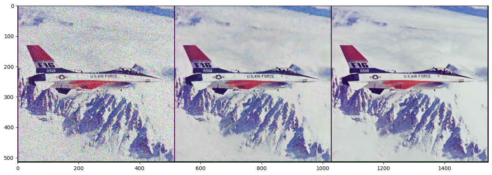
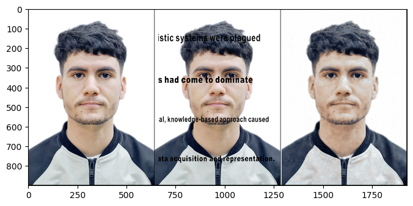
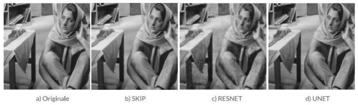

# Generative DNN for Image Reconstruction — Deep Image Prior

This M2 ATSI project (CentraleSupélec / Université Paris-Saclay) solves classic **inverse problems in imaging** (**denoising**, **inpainting** and **deconvolution**) with **untrained** convolutional generators. It follows the *Deep Image Prior* method (Ulyanov, Vedaldi & Lempitsky, CVPR 2018).

No dataset and no pre-training are involved. A randomly initialized network $f_\theta$ is fitted to **the single degraded image**. The network architecture itself acts as the image prior: it fits natural image structure much faster than noise.


*Denoising (Skip network, σ = 50/255): noisy input, DIP reconstruction, ground truth.*

---

## Method

The reconstruction replaces the hand-crafted regularizer $R(x)$ with the implicit prior of the network:

$$\theta^* = \arg\min_\theta \; E\big(f_\theta(z);\, x_0\big), \qquad x^* = f_{\theta^*}(z)$$

where $z$ is a fixed random tensor (32 channels) and $x_0$ is the degraded observation. Each task only changes the data term:

| Task | Data term $E(x; x_0)$ |
|---|---|
| Denoising | $\lVert x - x_0 \rVert^2$ |
| Inpainting | $\lVert (x - x_0) \odot m \rVert^2$, with $m$ the binary mask of known pixels |
| Deconvolution | $\lVert k * x - x_0 \rVert^2$, with $k$ the blur kernel (9×9 average) |

Early stopping matters: given enough iterations, the network ends up fitting the noise too.

**Three generator architectures are compared:** Skip (encoder-decoder with skip connections), U-Net, and ResNet. Classical baselines are included: **NL-means** for denoising and the **Wiener filter** for deconvolution.

## Results

**Denoising** (F16, σ = 0.196)

| | Skip | ResNet | U-Net | NL-means |
|---|---|---|---|---|
| SSIM ↑ | **0.730** | 0.531 | 0.723 | 0.672 |
| MSE ↓ | **0.00198** | 0.0043 | 0.0020 | 0.0043 |

**Inpainting** (text removal on a portrait)

| | Skip | ResNet | U-Net |
|---|---|---|---|
| SSIM ↑ | **0.855** | 0.787 | 0.824 |
| MSE ↓ | **0.0013** | 0.0019 | 0.0017 |



**Deconvolution** (Barbara, 9×9 blur)

| | Skip | ResNet | U-Net | Wiener |
|---|---|---|---|---|
| SSIM ↑ | **0.635** | 0.201 | 0.379 | 0.600 |
| MSE ↓ | **0.0049** | 0.0156 | 0.0110 | 0.0060 |



**Findings**
- The **Skip** architecture wins on all three tasks and beats the classical baselines.
- DIP interpolates textures and local structure well. It fails on **large missing semantic regions** (eyes, mouth), because it has no learned knowledge of faces.
- For noise + blur, the Skip network reaches SSIM 0.625 after 10 000 iterations.

The full analysis, with learning curves and limitations, is in the report: [`docs/report_generative_DNN_image_reconstruction.pdf`](docs/report_generative_DNN_image_reconstruction.pdf).

## Repository structure

```
denoising_skip.ipynb              denoising_resnet.ipynb        denoising_skip_custom_image.ipynb
inpainting_unet.ipynb             inpainting_resnet.ipynb
deconvolution_unet.ipynb          deconvolution_resnet.ipynb
models/    generator architectures: skip, UNet, ResNet, texture_nets, dcgan
utils/     image I/O, noise, optimization loop
data/      test images (F16, Barbara, Kate, vase)
docs/      project report and figures
```

## Run

```bash
git clone https://github.com/AISSAOUI-15/generative-image-reconstruction.git
cd generative-image-reconstruction
pip install -r requirements.txt
jupyter notebook denoising_skip.ipynb
```

The notebooks also run on **Google Colab**: the first cell clones the repository. A GPU is strongly recommended; allow a few minutes per task on a T4.

The notebooks keep their original outputs. Two of the images used are not included in the repository: the portrait used for inpainting and the photo used in `denoising_skip_custom_image.ipynb`. To re-run those notebooks, point `img_path` or `fname` to your own image, or use `kate.png` / `kate_mask.png`.

## Credits and license

- **Method and base code:** *Deep Image Prior*, D. Ulyanov, A. Vedaldi, V. Lempitsky, CVPR 2018 ([paper](https://arxiv.org/abs/1711.10925) · [code](https://github.com/DmitryUlyanov/deep-image-prior)). The `models/` and `utils/` folders and the test images in `data/` come from the official repository, under the **Apache 2.0** license ([`LICENSE-DeepImagePrior`](LICENSE-DeepImagePrior)). Only minor changes were made: comments, and `Image.ANTIALIAS` replaced with `Image.LANCZOS` for Pillow ≥ 10.
- **Experiments, comparisons, report:** the notebooks, the architecture comparison, the NL-means and Wiener baselines, and the report are original work, under the **MIT** license ([`LICENSE`](LICENSE)).

---

**Author:** Mohamed Aissaoui — M.Sc. Signal and Image Processing, CentraleSupélec · [LinkedIn](https://www.linkedin.com/in/mohamed-aissaoui15/)
